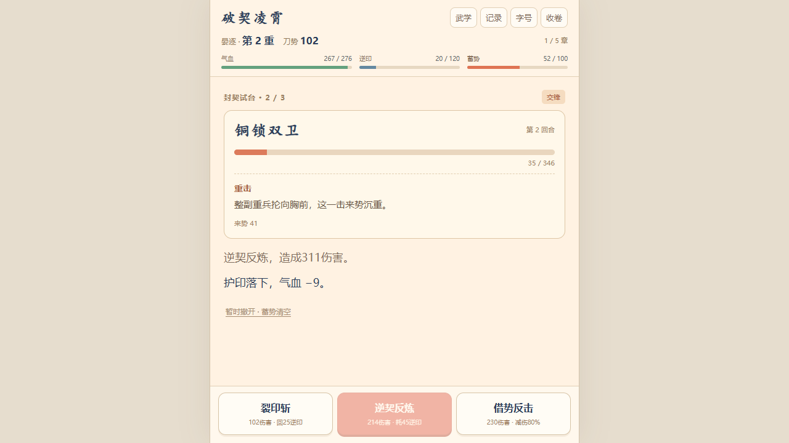

# 破契凌霄 / Poqi Lingxiao

**半成品留档，已停止开发。** 这是一个原创中文文字修行游戏原型，公开当前源码供研究、修改或继续制作。v0.8 不是正式完成版，也没有经过 TapTap 上线或手机真机验收。

原型使用原生 HTML、CSS、JavaScript，无需后端账号或构建框架。项目使用了 AI 辅助编程、文案和插画生成。

## 现有内容

- 五章、15 场主战、5 名可选精英与 5 个小事件。
- 斩击、反炼、反击和蓄势大招；敌人预告下一手，关底半血变招。
- 8 类可叠加法门，关底和精英胜后随机三选一。
- 普通战利品与突破自动结算，可用契砂疗伤、磨刀。
- 双结局，以及通关后的连续试炼；试炼轮换五种敌人，每三层可选法门。
- 浏览器本地存档，保留旧原型 v2/v3 书签的读取与转换逻辑。

这些功能说明只代表当前代码包含的内容，不代表已经达到成品质量。已知不足见 [STATUS.md](STATUS.md)。

 

## 本地运行

需要 Python 3.10 或更新版本，在仓库根目录运行：

```sh
python tests/preview_server.py
```

macOS/Linux 也可以使用 `python3`。然后在浏览器打开：

```text
http://127.0.0.1:61648/
```

服务器仅监听本机地址。Windows 可运行 `tests/start-preview.ps1`，在隐藏的 Python 进程中启动预览；脚本不会关闭占用相同端口的其他程序。

端口被占用时可运行 `python tests/preview_server.py --port 61649`，并改用对应地址。

也可以在 GitHub Releases 下载完整离线 HTML，直接用浏览器打开。离线文件与 HTTP 网站是不同来源，浏览器存档不会自动互通。

## 检查

核心逻辑检查只需要 Node.js 20 或更新版本，无第三方包：

```sh
npm test
```

可选浏览器检查需要 Playwright：

```sh
npm install
npx playwright install chromium
python tests/package.py
```

先在另一终端启动预览，再运行 `npm run test:browser`。默认使用 Playwright 的 Chromium，无头、静音运行；可以用 `CHROME_PATH` 指定已有的 Chrome 可执行文件，或用 `PREVIEW_URL` 指定另一预览地址。

## 打包

```sh
python tests/package.py
node tests/expedition-release-check.cjs
```

`release/` 中会生成完整离线 HTML、H5 目录包、源码包与 SHA-256 清单。目录版保持轻量入口，图片按场景请求；离线单文件将每张图片只内嵌一次。

## 源码结构

- `web/assets/expedition-engine.js`：当前战斗、成长、事件、试炼和存档逻辑。
- `web/assets/expedition-data.js`：当前短剧情、敌人、事件与法门文案。
- `web/assets/expedition-app.js`：界面、输入和浏览器存档。
- `web/assets/expedition.css`、`story.css`：样式。
- `text-data.js`、`text-engine.js`、`story-engine.js`：旧原型存档的兼容支持，不是另一个正在开发的版本。
- `web/assets/art/`：随仓库发布的生成插画。
- `tests/`：当前逻辑、浏览器与打包检查。

## 许可与素材

代码、项目文本和随仓库发布的生成插画采用 [MIT License](LICENSE)。插画生成来源和提示见 [ASSETS.md](ASSETS.md)。项目没有包含商业小说原文、封面或第三方游戏素材，也不表示获得任何小说 IP 的改编授权。

欢迎 fork 后自行修改。这个仓库按现状公开，不承诺继续更新。
